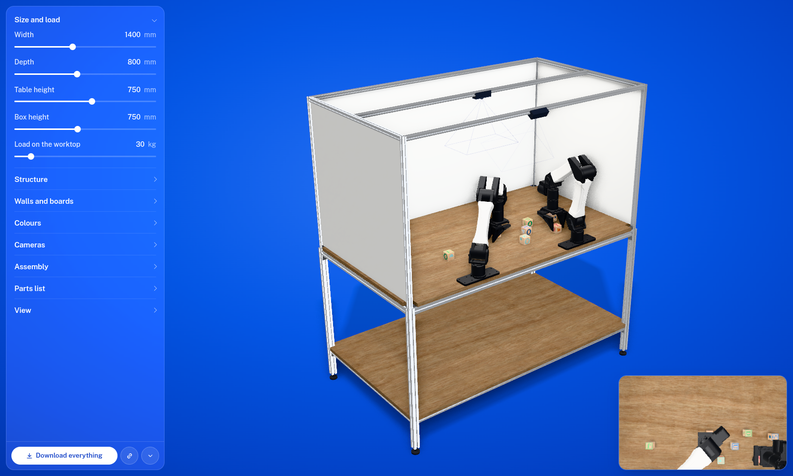

# Table Generator



Table Generator designs aluminium-extrusion eval tables for robot arms: a table with a box frame on top for the arm and its cameras, a shelf underneath, and feet or casters. You set the size and the load it has to carry. It gives you the table as a simulation asset and the parts and instructions to build the real one.

**Open it:** https://pham-tuan-binh.github.io/table-generator/

## How it works

You never choose the extrusion. Each part of the frame is sized for what it carries, and the cheapest option that does the job wins:

- **Legs** carry everything, so they're sized for sway and buckling.
- **Worktop and shelf rails** are sized for sag, together with how many support bars go under the board.
- **The box** only holds walls and cameras, so it stays 2020.

The default 1.4 m table, rated for 30 kg, gets 3030 legs and rails under a 2020 box. Rate it for 120 kg and the legs and rails become 4040, while the box stays 2020. The rules of thumb are in [`src/structure.ts`](src/structure.ts). They are design aids, not certification.

Where profiles of different sizes meet, everything sits on the legs' centre lines, so one bracket always reaches a slot on both. The parts list explains each joint and which slot width to buy.

Click any part to change it. Add cameras by clicking where they mount, and the preview shows what each one sees. A pair of [i2rt YAM](https://i2rt.com) arms works through [ToyBlocks](https://github.com/allenai/ToyBlocks) stacking tasks on the worktop, so you can judge the space before you build it.

## What you download

| File | What it's for |
| --- | --- |
| `mjcf/scene.xml` | MuJoCo, with cameras that render at their real resolution |
| `urdf/frame.urdf` | ROS, Isaac Sim, PyBullet, Gazebo. Mount your robot at `worktop_frame` |
| `usd/frame.usda` | Isaac Sim and Omniverse, with colliders and cameras |
| `frame.glb` | Blender and the web |
| `cameras.json` | Intrinsics and poses in ROS, OpenCV and OpenGL conventions |
| `bom.csv`, `cutlist.csv`, `panels/*.dxf` | Ordering, cutting and CNC |
| `README.md` | The checks, parts list, how it goes together, and the build steps |

The design lives in the URL, so a link is the whole table.

## Run it locally

```bash
npm install
npm run dev                              # the app
npm run generate -- params.json out/     # the same download, from the command line
```

Pushes to `main` deploy to GitHub Pages.

## Credits

The box-on-a-table layout comes from [SO-Frame](https://github.com/livekit-examples/so-frame). The YAM arm model is MuJoCo Menagerie's [`i2rt_yam`](https://github.com/google-deepmind/mujoco_menagerie/tree/main/i2rt_yam) (MIT, i2rt robotics). The alphabet blocks and the stacking task come from AllenAI's [ToyBlocks](https://github.com/allenai/ToyBlocks) (Apache-2.0). The studio lighting and plywood come from [Poly Haven](https://polyhaven.com) (CC0).
